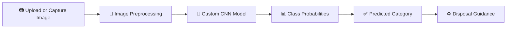

 <div align="center">

# ♻️ Smart Waste Segregation System

### *Snap it. Classify it. Dispose it right.*

AI-powered waste classification using Deep Learning


**Team SOLOFORGE** · *One Mind. One Mission. One Creation.*

[🌐 Live Demo](#-live-demo) · [🚀 Quick Start](#-quick-start) · [📊 Model Performance](#-model-performance) · [🔮 Roadmap](#-roadmap)

</div>

---

## 🌍 Overview

Improper waste segregation is a major challenge for effective recycling. Many recyclable materials end up mixed with general waste because people are unsure how to identify and dispose of different waste items.

**Smart Waste Segregation System** is an AI-powered image classification application designed to make waste identification easier.

Users can upload an image or capture one using a camera. A custom Convolutional Neural Network (CNN), built with TensorFlow and Keras, analyzes the image and predicts its waste category.

The application displays the predicted category, confidence score, alternative predictions, and disposal guidance.

## 🎯 Problem Statement (GP-05)

| Challenge | Impact |
|---|---|
| Improper segregation at source | Contaminated recycling streams |
| Manual identification is slow and inconsistent | Human error and wasted effort |
| Lack of disposal awareness | Recyclable materials may end up in landfills |

**Our approach:** Use deep learning-based image classification to make waste identification more accessible and support better waste segregation practices.

## ✨ Features

- 📤 **Image Upload:** Upload waste images through a simple Streamlit interface.
- 📷 **Camera Capture:** Capture an image directly using the camera.
- 🧠 **Custom CNN Model:** Deep learning-based classification using TensorFlow/Keras.
- 📊 **Confidence Scores:** View the model's prediction score.
- 🥇 **Top 3 Predictions:** Explore alternative categories predicted by the model.
- ♻️ **Disposal Guidance:** Get category-specific waste disposal suggestions.
- 🎨 **Interactive UI:** Clean, responsive dark-themed application.

## 🔄 How It Works



### Classification Pipeline

1. User uploads or captures a waste image.
2. The image is converted to RGB format.
3. Image dimensions are resized to **128 × 128 pixels**.
4. Pixel values are normalized to the range 0–1.
5. The trained CNN processes the image.
6. The model generates probabilities for six waste categories.
7. The application displays the predicted category, confidence score, and top alternative predictions.
8. Relevant disposal guidance is displayed.

## 🧠 Model Architecture

The project uses a **custom Convolutional Neural Network (CNN)** developed using TensorFlow/Keras.

### Architecture Overview

| Layer | Configuration |
|---|---|
| Input | 128 × 128 × 3 |
| Convolutional Layer 1 | 32 filters, ReLU |
| Max Pooling 1 | MaxPooling2D |
| Convolutional Layer 2 | 64 filters, ReLU |
| Max Pooling 2 | MaxPooling2D |
| Convolutional Layer 3 | 128 filters, ReLU |
| Max Pooling 3 | MaxPooling2D |
| Global Pooling | GlobalAveragePooling2D |
| Dense Layer | 128 units, ReLU |
| Dropout | 0.3 |
| Output Layer | 6 units, Softmax |

### Training Configuration

| Parameter | Value |
|---|---|
| Input Image Size | 128 × 128 × 3 |
| Batch Size | 32 |
| Maximum Epochs | 26 |
| Optimizer | Adam |
| Initial Learning Rate | 0.001 |
| Loss Function | Sparse Categorical Crossentropy |
| Output Activation | Softmax |
| Class Imbalance Handling | Class Weights |
| Early Stopping | Enabled |
| Learning Rate Reduction | ReduceLROnPlateau |
| Model Checkpointing | Best validation-loss model |
| Total Parameters | 110,534 |

## 📊 Model Performance

The trained model was evaluated on a **separate test dataset containing 19,930 images**.

<details>
<summary><strong>Overall Evaluation Results</strong></summary>

| Metric | Result |
|---|---:|
| Architecture | Custom CNN |
| Number of Classes | 6 |
| Input Size | 128 × 128 × 3 |
| Validation Accuracy | 78.42% |
| Test Accuracy | **81.22%** |
| Test Loss | 0.5404 |
| Test Images | 19,930 |
| Correct Predictions | 16,187 |
| Incorrect Predictions | 3,743 |
| Total Parameters | 110,534 |

</details>

### Class-wise Classification Report

| Category | Precision | Recall | F1-Score |
|---|---:|---:|---:|
| Cardboard | 84% | 88% | 86% |
| Glass | 88% | 83% | 85% |
| Metal | 76% | 87% | 81% |
| Paper | 81% | 86% | 83% |
| Plastic | 85% | 66% | 74% |
| Trash | 67% | 83% | 74% |

**Observations:**

- Cardboard and Glass show comparatively strong classification performance.
- Metal and Paper also achieve balanced results.
- Plastic has comparatively lower recall, indicating scope for improvement.
- Trash has comparatively lower precision, indicating some false-positive predictions.

> **Note:** Test accuracy represents performance on the evaluated test dataset. Real-world performance may vary depending on image quality, lighting, background, and object characteristics.

## 🗂️ Supported Waste Categories

The model supports six waste categories:

| Category | Examples | Disposal Guidance |
|---|---|---|
| 📦 Cardboard | Boxes and packaging | Keep clean and dry for recycling |
| 🍾 Glass | Bottles and jars | Follow local glass recycling guidelines |
| 🥫 Metal | Aluminium cans and containers | Empty and rinse before recycling |
| 📄 Paper | Newspapers, sheets and magazines | Keep dry and clean |
| 🧴 Plastic | Bottles, wrappers and containers | Follow local plastic recycling rules |
| 🗑️ Trash | Non-recyclable or residual waste | Follow local residual waste guidelines |

## 🖥️ Application Preview

| Waste Image Upload | Prediction Result |
|---|---|
|  |  |

*Add your application screenshots to the `assets/` directory.*

## 🛠️ Tech Stack

| Layer | Technologies |
|---|---|
| Programming Language | Python 3.12 |
| Deep Learning | TensorFlow, Keras |
| Model Architecture | Custom CNN |
| Web Application | Streamlit |
| Image Processing | Pillow, NumPy |
| Evaluation | Scikit-learn |
| Visualization | Matplotlib, Seaborn |
| Dataset | MWCD-based merged waste classification dataset |

## 📁 Project Structure

```text
Smart-Waste-Segregation/
│
├── app.py
├── model.py
├── requirements.txt
├── README.md
│
├── models/
│   ├── best_waste_cnn.keras
│   └── class_names.json
│
├── assets/
│   ├── home.png
│   └── result.png
│
└── ...
```

*The structure above represents the main project files. Update it if your repository contains additional folders or files.*

## 🚀 Quick Start

### 1. Clone the Repository

```bash
git clone YOUR_GITHUB_REPOSITORY_URL
cd YOUR_PROJECT_FOLDER
```

### 2. Create a Virtual Environment

```bash
python -m venv venv
```

Activate it on Windows:

```bash
venv\Scripts\activate
```

For macOS/Linux:

```bash
source venv/bin/activate
```

### 3. Install Dependencies

```bash
pip install -r requirements.txt
```

### 4. Run the Application

```bash
streamlit run app.py
```

Open the local URL displayed in your terminal, usually:

```text
http://localhost:8501
```

**Important:** The trained model file and `class_names.json` must be present in the expected `models/` directory for the application to work.

## 🌐 Live Demo

🔗 **Streamlit App:** Coming soon

## 🔮 Roadmap

- [x] Develop a custom CNN-based waste classification model.
- [x] Support six waste categories.
- [x] Build an interactive Streamlit application.
- [x] Implement image upload and camera capture.
- [x] Display confidence scores and top 3 predictions.
- [x] Add category-specific disposal guidance.
- [x] Evaluate the model on a separate test dataset.
- [ ] Improve classification performance for Plastic and Trash.
- [ ] Test with more diverse real-world images.
- [ ] Add confusion matrix and model evaluation visualizations.
- [ ] Explore lightweight model optimization.
- [ ] Investigate multi-object waste detection.

## ⚠️ Limitations

- The system currently classifies one primary waste item per image.
- It supports only the six categories included in the training dataset.
- Prediction reliability may decrease for unusual objects, cluttered backgrounds, poor lighting, or images outside the training distribution.
- Confidence scores are model estimates, not guarantees of correct classification.
- Disposal recommendations are general guidance; local recycling rules may differ.

This project is a hackathon prototype and should be treated as a decision-support tool rather than a replacement for official waste management guidelines.

## 👥 Team SOLOFORGE

Built for **Neural Storm 2026 · Problem Statement GP-05**

<div align="center">

**One Mind. One Mission. One Creation.**

*Built with ❤️ using Python, Deep Learning, and Streamlit.*

</div>
