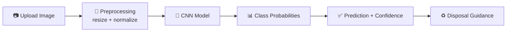

<div align="center">
 
# ♻️ Smart Waste Segregation System
 
### *Snap it. Classify it. Dispose it right.*
 
AI-powered waste classification using Deep Learning
 


 
**Team SOLOFORGE** · *One Mind. One Mission. One Creation.*
 
[🌐 Live Demo](#-live-demo) · [🚀 Quick Start](#-quick-start) · [📊 Model Performance](#-model-performance) · [🔮 Roadmap](#-roadmap)
 
</div>
 
---
 
## 🌍 Overview
 
Wrong waste in the wrong bin is one of the biggest reasons recycling fails. Most people simply don't know *where* a given item belongs.
 
**Smart Waste Segregation System** fixes that in one step: upload a photo of a waste item, and a Convolutional Neural Network (CNN) tells you **what it is**, **how confident it is**, and **how to dispose of it properly**.
 
## 🎯 Problem Statement (GP-05)
 
| Challenge | Impact |
|---|---|
| Improper segregation at source | Contaminated recycling streams |
| Manual identification is slow and inconsistent | Human error, wasted effort |
| Lack of disposal awareness | Recyclable material ends up in landfills |
 
**Our approach:** use AI-based image classification to make waste identification instant, consistent, and accessible to anyone with a camera.
 
## ✨ Features
 
- 📤 **Simple image upload** through a clean Streamlit interface
- 🧠 **CNN-based classification** built with TensorFlow / Keras
- 📈 **Confidence score** for every prediction
- 🥈 **Top alternative predictions**, so users see the model's second opinions
- 🗑️ **Disposal guidance** tailored to the predicted category
 
## 🔄 How It Works
 

 
1. User uploads a waste image
2. Image is resized and normalized
3. Trained CNN processes the image
4. Model outputs probabilities for each class
5. App shows the top prediction, confidence, and alternatives
6. Disposal guidance is displayed
 
## 🧠 Tech Stack
 
| Layer | Tools |
|---|---|
| Language | Python |
| Deep Learning | TensorFlow, Keras (CNN) |
| Web App | Streamlit |
| Image Handling | Pillow, NumPy |
| Visualization | Matplotlib |
 
## 📊 Model Performance
 
| Metric | Result |
|---|---|
| Architecture | `<!-- e.g. Custom CNN / MobileNetV2 transfer learning -->` |
| Number of Classes | `<!-- e.g. 6 -->` |
| Training Accuracy | `<!-- XX.X% -->` |
| Validation Accuracy | `<!-- XX.X% -->` |
| Test Accuracy | `<!-- XX.X% -->` |
 
> 📌 Replace the placeholders above with your final evaluation numbers before submission.
 
### 🗂️ Supported Waste Categories
 
<!-- Example: Cardboard · Glass · Metal · Paper · Plastic · Trash -->
 
## 🖥️ Screenshots
 
| Home Page | Prediction Result |
|---|---|
|  |  |
 
<!-- Add a training-curve / confusion matrix image in assets/ and reference it here -->
 
## 🚀 Quick Start
 
**1. Clone the repository**
 
```bash
git clone YOUR_GITHUB_REPOSITORY_URL
cd YOUR_PROJECT_FOLDER
```
 
**2. (Recommended) Create a virtual environment**
 
```bash
python -m venv venv
venv\Scripts\activate        # Windows
# source venv/bin/activate   # macOS / Linux
```
 
**3. Install dependencies**
 
```bash
pip install -r requirements.txt
```
 
**4. Launch the app**
 
```bash
streamlit run app.py
```
 
Then open the local URL shown in your terminal (usually `http://localhost:8501`).
 
## 🌐 Live Demo
 
🔗 **Streamlit App:** *Coming soon*
 
## 📁 Project Structure
 
```text
├── app.py                # Streamlit application
├── model/                # Trained model files
├── notebooks/            # Training & evaluation notebooks
├── assets/               # Screenshots and images
├── requirements.txt
└── README.md
```
 
> Adjust this tree to match your actual repository layout.
 
## 🔮 Roadmap
 
- [ ] Improve accuracy on real-world, cluttered images
- [ ] Expand and diversify the training dataset
- [ ] Object detection for images with multiple waste items
- [ ] Richer, region-specific recycling guidance
- [ ] Mobile-friendly / camera-based live capture
 
## ⚠️ Limitations
 
This is a hackathon prototype. Predictions may be less reliable on unusual lighting, heavily damaged items, or objects outside the trained categories.
 
## 👥 Team SOLOFORGE
 
Built for **Neural Storm 2026 · Problem Statement GP-05**
 
<div align="center">
 
**One Mind. One Mission. One Creation.**
 
*Built with ❤️ using Python, Deep Learning, and Streamlit*
 
</div>
 
